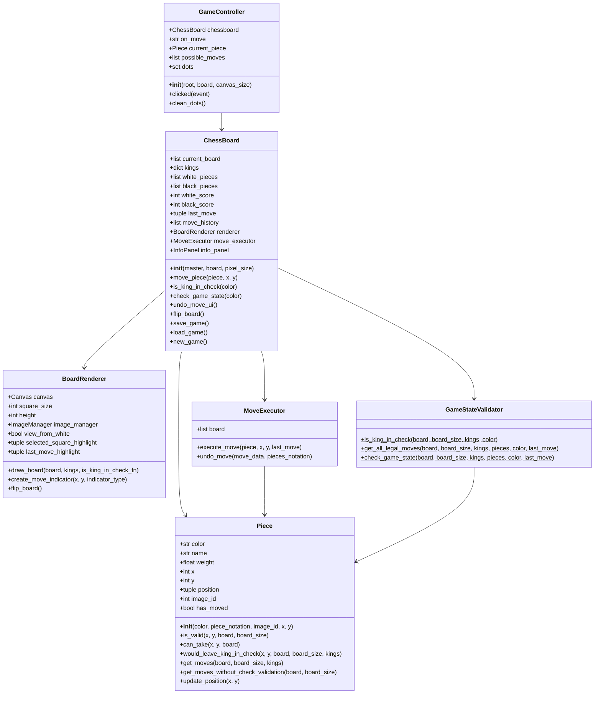
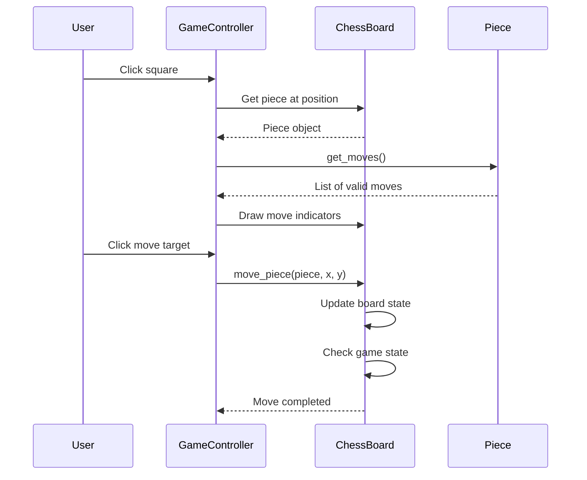
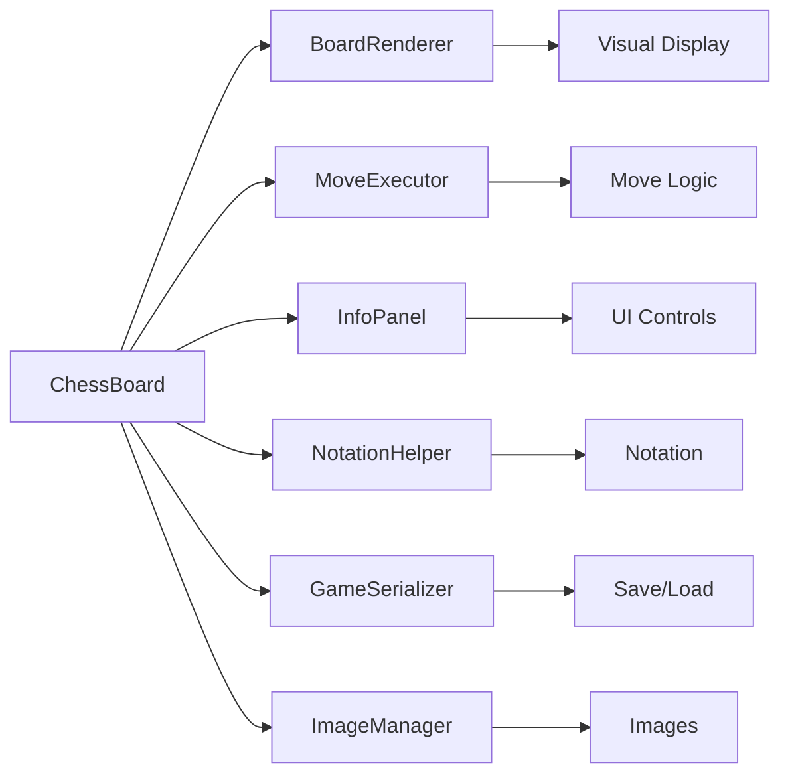
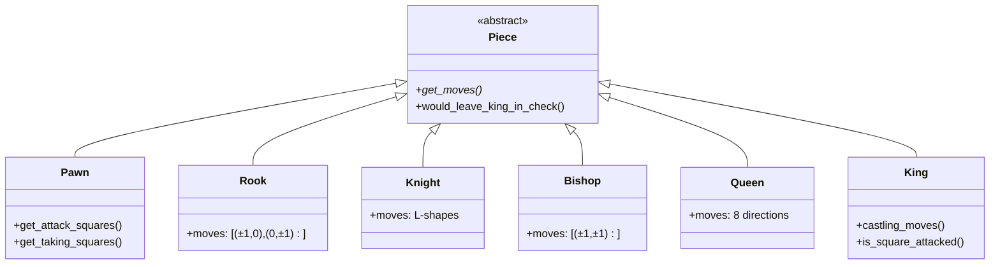

# Chess Game API Reference

## Overview
This document provides detailed API documentation for the chess game's core components.

## Class Diagram



## Core Components

### GameController

Main game controller handling user interactions.



**Methods:**

- `__init__(root, board, canvas_size)` - Initialize game controller
- `clicked(event)` - Handle mouse click events
- `clean_dots()` - Remove move indicator dots

### ChessBoard

Central orchestrator managing game state and components.



**Properties:**
- `current_board: list[list]` - 8x8 board representation
- `kings: dict` - Reference to both kings
- `white_pieces: list` - All white pieces
- `black_pieces: list` - All black pieces
- `white_score: int` - White's captured material
- `black_score: int` - Black's captured material
- `last_move: tuple` - Last move made (piece, from, to)
- `move_history: list[dict]` - Complete move history

**Key Methods:**

```python
def move_piece(piece: Piece, x: int, y: int) -> tuple:
    """
    Execute a move and return captured piece info
    
    Args:
        piece: The piece to move
        x: Target row
        y: Target column
    
    Returns:
        Captured piece (if any)
    """
```

```python
def is_king_in_check(color: str) -> bool:
    """
    Check if a king is in check
    
    Args:
        color: 'w' or 'b'
    
    Returns:
        True if king is in check
    """
```

```python
def check_game_state(color: str) -> str:
    """
    Determine current game state
    
    Args:
        color: Color to check
    
    Returns:
        CHECKMATE, STALEMATE, or IN_PROGRESS
    """
```

### Piece Classes

Base class and all piece types.



## Usage Examples

### Create a new game

```python
import tkinter as tk
from main import GameController

root = tk.Tk()
root.title("Chess")

initial_board = [
    ["bR", "bN", "bB", "bQ", "bK", "bB", "bN", "bR"],
    ["bP", "bP", "bP", "bP", "bP", "bP", "bP", "bP"],
    [".", ".", ".", ".", ".", ".", ".", "."],
    [".", ".", ".", ".", ".", ".", ".", "."],
    [".", ".", ".", ".", ".", ".", ".", "."],
    [".", ".", ".", ".", ".", ".", ".", "."],
    ["wP", "wP", "wP", "wP", "wP", "wP", "wP", "wP"],
    ["wR", "wN", "wB", "wQ", "wK", "wB", "wN", "wR"]
]

game = GameController(root, initial_board, 800)
root.mainloop()
```

### Get legal moves for a piece

```python
from pieces import Knight
from constx import WHITE

knight = Knight(WHITE, 0, 7, 1)
board[7][1] = knight

legal_moves = knight.get_moves(board, 8, kings)
# Returns: [(5, 0), (5, 2), (6, 3)]
```
