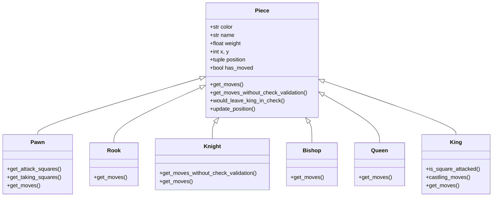
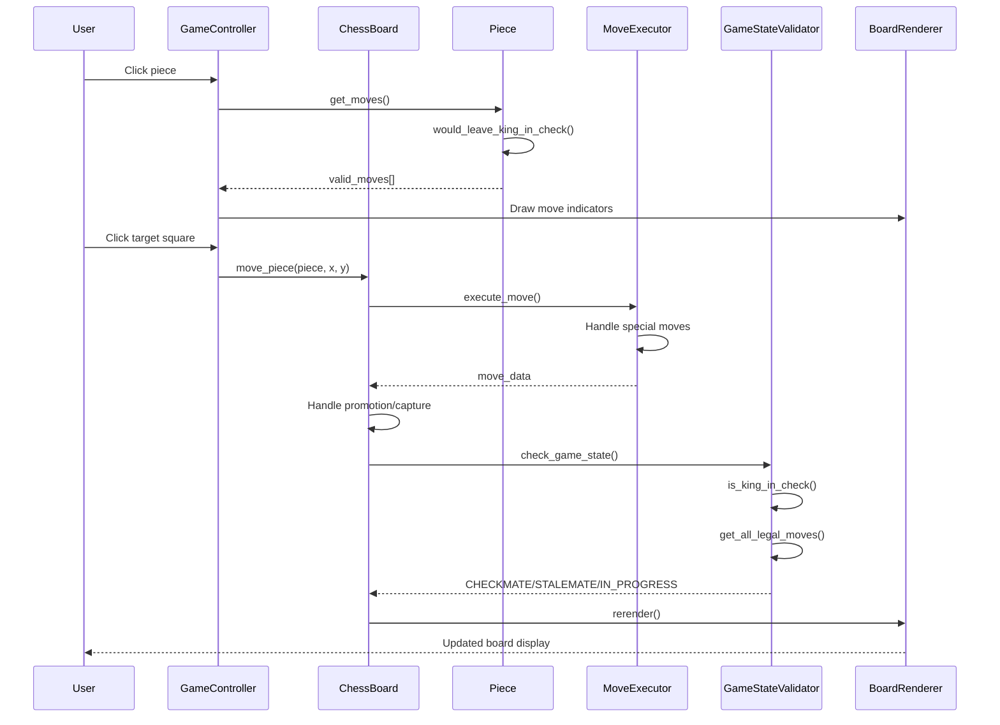
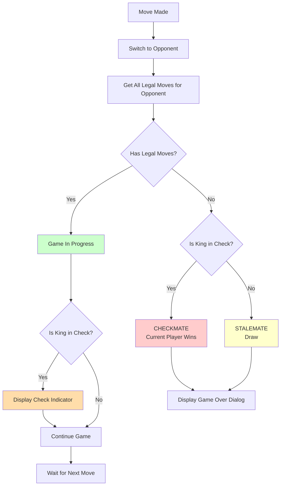
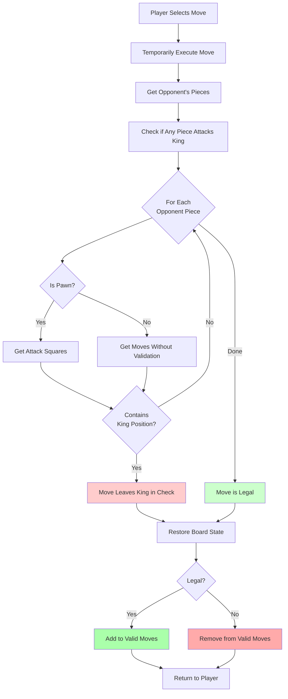
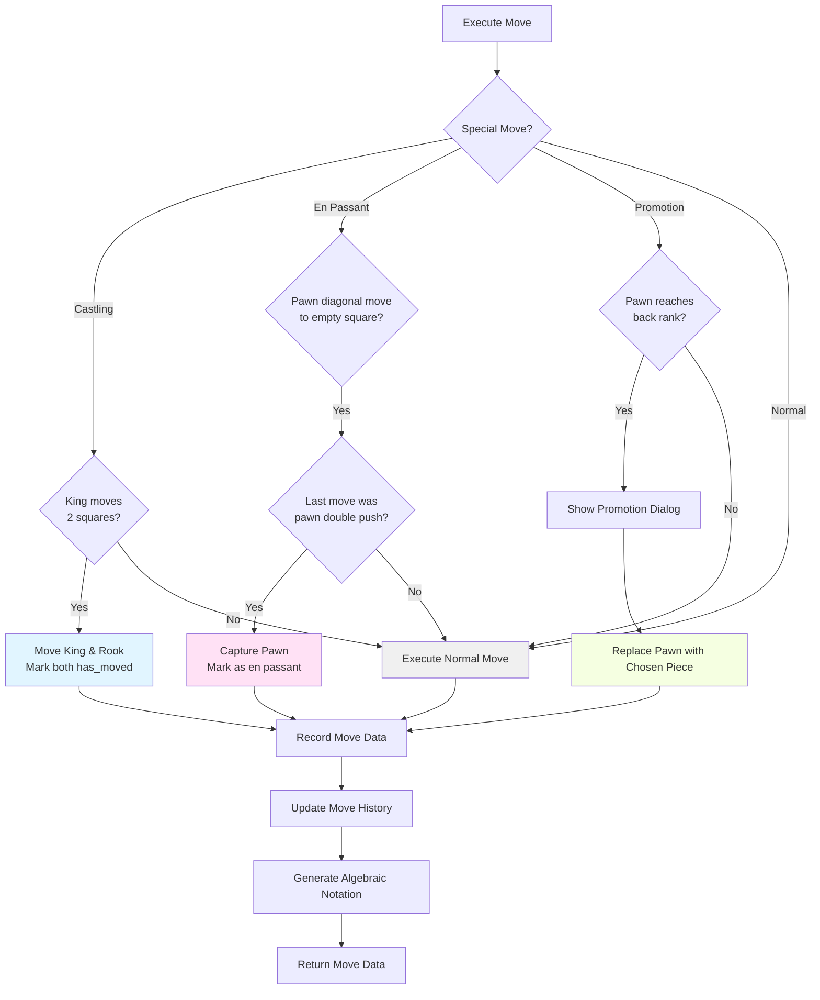
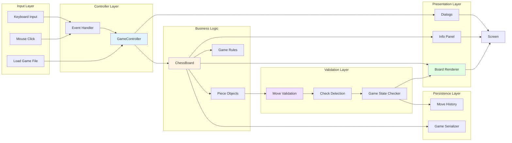
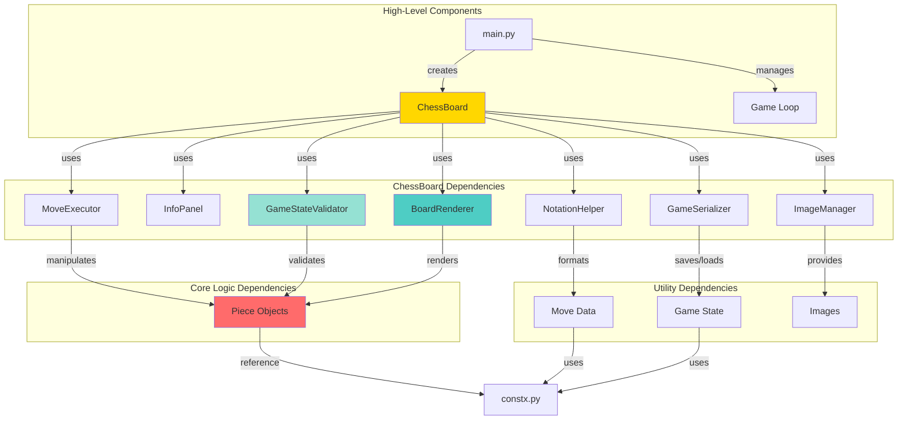

# Chess Game Architecture

## Project Structure Diagram

```mermaid
graph TB
    subgraph "Entry Point"
        Main[main.py<br/>GameController]
    end
    
    subgraph "Core Board Management"
        Board[board.py<br/>ChessBoard]
    end
    
    subgraph "Game Logic"
        GameState[game_logic/game_state.py<br/>GameStateValidator]
        MoveExec[game_logic/move_executor.py<br/>MoveExecutor]
    end
    
    subgraph "Pieces"
        Pieces[pieces.py<br/>Piece, Pawn, Rook<br/>Knight, Bishop<br/>Queen, King]
    end
    
    subgraph "UI Components"
        Renderer[ui/board_renderer.py<br/>BoardRenderer]
        InfoPanel[ui/info_panel.py<br/>InfoPanel, ControlPanel]
    end
    
    subgraph "Utilities"
        Notation[utils/notation.py<br/>NotationHelper]
        GameIO[utils/game_io.py<br/>GameSerializer]
        ImageMgr[utils/image_manager.py<br/>ImageManager]
    end
    
    subgraph "Constants"
        Constx[constx.py<br/>WHITE, BLACK<br/>CHECKMATE, etc.]
    end
    
    Main --> Board
    Main --> GameState
    Board --> MoveExec
    Board --> GameState
    Board --> Renderer
    Board --> InfoPanel
    Board --> Notation
    Board --> GameIO
    Board --> ImageMgr
    Board --> Pieces
    MoveExec --> Pieces
    GameState --> Pieces
    Renderer --> ImageMgr
    Renderer --> Pieces
    Pieces --> Constx
    Board --> Constx
    Main --> Constx
    
    style Main fill:#e1f5ff
    style Board fill:#fff4e1
    style GameState fill:#f0e1ff
    style MoveExec fill:#f0e1ff
    style Pieces fill:#ffe1e1
    style Renderer fill:#e1ffe1
    style InfoPanel fill:#e1ffe1
```

## Class Hierarchy



## Move Execution Flow



## Game State Detection Flow



## Check Validation Flow



## Special Moves Handling



## Data Flow Architecture



## Component Interaction Matrix


